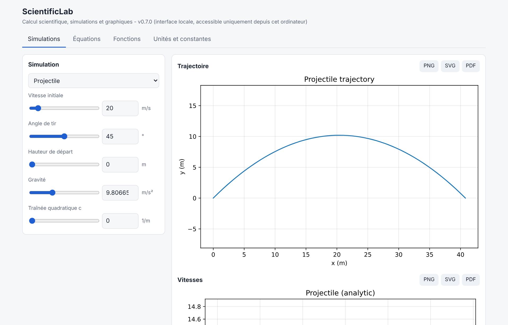
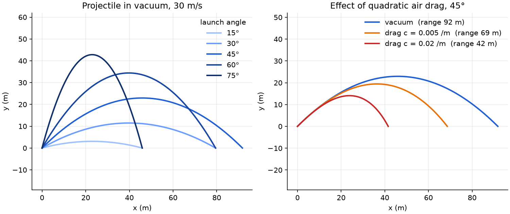
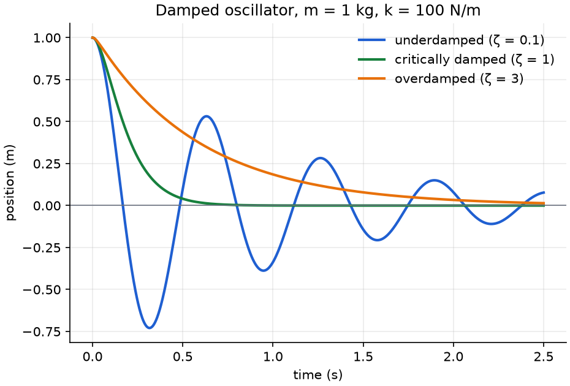
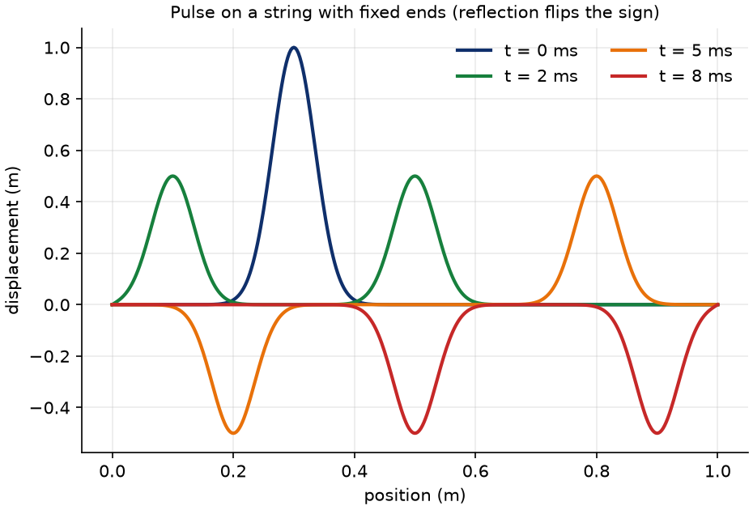
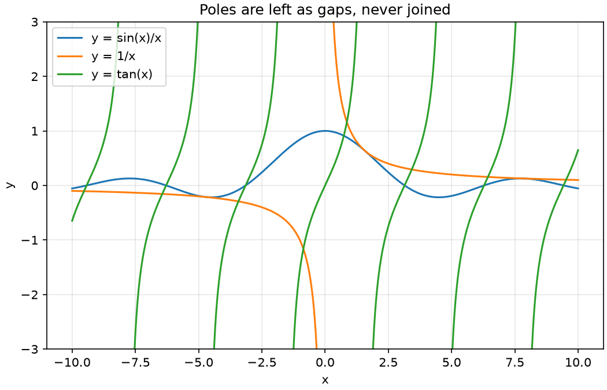
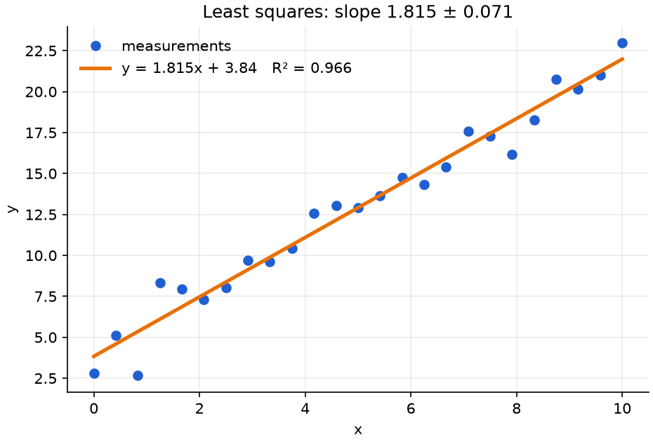

<p align="center"></p>

# ScientificLab

**Mathematical & Physics Computing Toolkit**

<!-- Replace OWNER with the GitHub account hosting the repository (see docs/releasing.md). -->
[](https://pypi.org/project/scientificlab/)
[](https://pypi.org/project/scientificlab/)
[](LICENSE)
[](https://github.com/OWNER/ScientificLab/actions/workflows/ci.yml)
[](https://OWNER.github.io/ScientificLab/)

> ScientificLab is an open-source Python library for mathematical computation, equation solving, numerical analysis, physics calculations, scientific simulations, and data visualization.

ScientificLab favours **scientific accuracy over feature count**: every function performs a real calculation, validates its inputs, documents its units, sign conventions and limits, and is tested against known reference values. Inconsistent results are never returned silently.

> **Status: v0.7.0 (beta).** All six development phases are complete. While the major version is 0, a minor release may change the public API; every change is listed in the [CHANGELOG](CHANGELOG.md). Documentation: [docs/](docs/index.md) (build it with `mkdocs serve`).

## Gallery

Every figure below is produced by ScientificLab itself (`python scripts/make_readme_figures.py`).

<p align="center"></p>

| | |
| --- | --- |
|  |  |
| Projectile: launch angles, and quadratic drag solved with RK45 | Damped oscillator: the three regimes, closed form |
|  |  |
| String wave: reflection at a fixed end flips the sign | Poles are drawn as gaps, never joined |

## Features

**Mathematics - algebra** (`scientificlab.mathematics.algebra`)

| Function | Description |
| --- | --- |
| `solve_linear(a, b)` | Solves `a*x + b = 0`; reports no / infinitely many solutions explicitly |
| `solve_quadratic(a, b, c)` | Real and complex roots, numerically stable, with discriminant and root nature |
| `polynomial_roots(coefficients)` | Roots of any polynomial (numerical, via companion matrix) |
| `expand_expression`, `factor_expression`, `simplify_expression` | Exact symbolic manipulation (SymPy) |
| `solve_system(equations)` | Exact solutions of linear and nonlinear systems (SymPy) |

**Mathematics - calculus** (`scientificlab.mathematics.calculus`, exact results via SymPy)

| Function | Description |
| --- | --- |
| `differentiate(expr, variable, order)` | Exact derivatives of any order |
| `partial_derivative(expr, variables)` | Partial and mixed derivatives |
| `indefinite_integral`, `definite_integral` | Exact integrals, including improper ones (`"oo"` bounds); divergent integrals raise `SolverError` |
| `limit(expr, variable, point, direction)` | Two-sided and one-sided limits; non-existent limits raise `SolverError` |
| `taylor_series(expr, variable, point, order)` | Taylor/Maclaurin polynomial (no remainder term) |
| `series_sum(expr, variable, start, end)` | Exact finite and infinite sums, e.g. `pi**2/6` |

**Mathematics - linear algebra** (`scientificlab.mathematics.linear_algebra`, NumPy)

| Function | Description |
| --- | --- |
| `matrix_add`, `matrix_multiply`, `dot_product`, `vector_norm` | Validated basic operations |
| `determinant`, `inverse`, `condition_number` | Singular matrices raise `SingularMatrixError` |
| `solve_linear_system(A, b)` | LU solve, with residual and condition number; `IllConditionedWarning` when `kappa > 1e10` |
| `eigen_decomposition`, `eigenvalues`, `eigenvectors` | Real and complex eigenpairs; warns on defective matrices |

**Mathematics - differential equations** (`scientificlab.mathematics.differential_equations`)

| Function | Description |
| --- | --- |
| `solve_ode("y'' + y = 0", initial_conditions={...})` | Exact first/second-order ODEs; every solution is checked by substitution (`verified`) |
| `solve_ode_numeric(rhs, t_span, y0)` | Initial-value problems and systems (SciPy; explicit and stiff methods) |
| `solve_second_order_numeric(acceleration, ...)` | `y'' = f(t, y, y')` as a first-order system |

**Mathematics - numerical methods** (`scientificlab.mathematics.numerical_methods`)

| Function | Description |
| --- | --- |
| `newton_raphson`, `bisection`, `secant` | Root finding; each documents its convergence conditions and raises `ConvergenceError` on failure |
| `linear_interpolation`, `polynomial_interpolation` | Piecewise-linear and Newton-form polynomial interpolation |
| `trapezoid_rule`, `simpson_rule`, `adaptive_integral` | Numerical integration (adaptive version returns an error estimate) |
| `numerical_derivative` | Central / forward / backward finite differences |

**Physics - classical mechanics** (`scientificlab.physics.mechanics`, SI units)

- Kinematics: distance, average speed/velocity, numerical instantaneous velocity, acceleration, uniform and uniformly accelerated motion, free fall, uniform circular motion
- Dynamics: Newton's second law, weight, friction, centripetal force, momentum
- Energy and work: kinetic, potential and mechanical energy, work of a force, power

**Physics - electricity** (`scientificlab.physics.electricity`)

- `ohms_law(voltage=, current=, resistance=)` solves for the missing quantity; a negative or infinite resistance raises `PhysicalInconsistencyError`
- `electric_power`, `electric_energy`, `series_resistance`, `parallel_resistance`
- Capacitors: charge, capacitance, stored energy, parallel-plate capacitance (CODATA 2022 `epsilon_0`)
- Series RC circuit: `rc_time_constant`, `rc_voltage`, `rc_discharge_voltage`, `rc_current`, `rc_time_to_voltage` (rejects voltages that are never reached)

**Physics - thermodynamics** (`scientificlab.physics.thermodynamics`)

- `heat_energy` (`Q = m c dT`), `latent_heat`, `convert_temperature` (K / C / F, rejects values below absolute zero)
- `ideal_gas(pressure=, volume=, amount=, temperature=)` solves `PV = nRT` for the missing quantity
- Work (sign: positive when done by the gas): `isobaric_work`, `isothermal_work`, `adiabatic_work`, `adiabatic_pressure`
- `carnot_efficiency`, `thermal_efficiency` (rejects efficiencies above 1 and, when temperatures are given, above the Carnot limit), `efficiency_from_heats`

**Physics - optics** (`scientificlab.physics.optics`)

- `snell_refraction` reports total internal reflection in its result; `critical_angle`, `reflection_angle`
- `thin_lens_equation` (real-is-positive convention; an image at infinity raises), `linear_magnification`, `lens_power`, `lensmaker_focal_length`, `magnifier_angular_magnification`, `telescope_magnification`

**Physics - waves** (`scientificlab.physics.waves`)

- `wave_relation(speed=, frequency=, wavelength=)`, `period_from_frequency`, `frequency_from_period`, `string_wave_speed`, `wave_displacement`
- Sound: `sound_speed_in_air`, `sound_speed_ideal_gas`, `sound_intensity_level`, `intensity_from_level`, `doppler_frequency` (rejects supersonic sources)
- `superpose` (same-frequency sinusoids; reports total cancellation), `beat_frequency`

**Physics - fluid mechanics** (`scientificlab.physics.fluid_mechanics`)

- `density`, `pressure`, `hydrostatic_pressure` (gauge or absolute), `hydraulic_force` (Pascal), `buoyant_force` (Archimedes), `floats`, `submerged_fraction`
- `volumetric_flow_rate`, `mass_flow_rate`, `continuity_velocity`, `bernoulli_pressure` (rejects flows needing a negative absolute pressure)

**Mathematics - statistics** (`scientificlab.mathematics.statistics`)

| Function | Description |
| --- | --- |
| `mean`, `median`, `variance(data, ddof=1)`, `standard_deviation`, `quantile` | Descriptive statistics (sample variance by default; quantile type 7) |
| `describe(data)` | `Summary`: count, mean, median, SD, min, max, quartiles, IQR |
| `covariance`, `correlation` | Pearson correlation; a constant sample raises `InvalidInputError` |
| `linear_regression(x, y)` | Least squares `LinearFit`: slope, intercept, R², standard errors, `predict` (needs >= 3 points, non-constant data) |
| `confidence_interval_mean(data, level=0.95)` | Student-t confidence interval |
| `normal_pdf`, `normal_cdf`, `normal_quantile` | Normal distribution |

Plots: `plot_histogram`, `plot_regression`. Results are validated against `scipy.stats`.

<p align="center"></p>

**Simulations (Phase 5)** (`scientificlab.simulations`)

| Function | Method |
| --- | --- |
| `simulate_projectile(speed, angle_degrees, height=, gravity=, drag=)` | closed form in vacuum; RK45 (rtol 1e-10) with quadratic drag |
| `simulate_free_fall(height, drag=)` | closed form (with drag: `tanh` solution, terminal speed) |
| `simulate_harmonic_oscillator(mass, stiffness, damping=)` | closed form, all regimes (under/critical/over-damped) |
| `simulate_rc_circuit(Vs, R, C)` | closed form with exact energy balance |
| `simulate_cooling(T0, T_amb, k)`, `cooling_time_to_reach` | Newton's law, closed form |
| `simulate_string_wave(L, c, u0)` | explicit finite differences; Courant number checked (<= 1) |

Each result states its `method`, model `notes` and derived `summary`. Tests compare against closed-form references, independent ODE integration, energy conservation and convergence order.

**Graphical interface** - `scientificlab-gui` (or `python -m scientificlab.gui`) opens a local page in your browser with live sliders for every simulation, the equation solver, function plots, unit conversion and the constants table; plots export to PNG, SVG or PDF. It uses only the standard library (no Tkinter, no new dependency) and is reachable only from your own computer: loopback address, per-session token, `Host`/`Origin` checks.

**Scientific tools (Phase 4)**

- `scientificlab.constants`: 18 constants as `Constant` records (value, unit, uncertainty, source, CODATA 2022 / SI 2019 edition) via `get_constant("G")`; `.quantity` gives a Pint quantity. Values are cross-checked against SciPy's CODATA table in the tests.
- `scientificlab.units`: `Q_`, `convert(value, from_unit, to_unit)` with dimension checks (`IncompatibleUnitsError`, `UnknownUnitError`), correct offset temperatures and rejection of temperatures below absolute zero; `scientificlab.units.physics` wraps physics functions (`kinetic_energy`, `average_speed`, `heat_energy`, ...) so they accept any compatible unit and return quantities. An absolute `degC` is refused where a temperature *difference* is expected.
- `scientificlab.solvers`: `EquationSolver` / `solve_equation` / `solve_system`. Results carry `exact`, `complete` and `verified` flags: polynomial and rational equations are solved exactly and completely; transcendental ones are flagged possibly incomplete; numerical search runs only when you pass `initial_guess`. No "solution steps" are produced because the engine cannot justify them.
- `scientificlab.visualization`: `plot_function(s)`, `plot_data`, `plot_histogram`, `plot_regression`, `plot_rc_charging`, `plot_position_vs_time`, `plot_isotherms`; export to PNG, SVG or PDF by file extension. Poles and undefined points are shown as gaps, never joined.

```python
from scientificlab.units import Q_, convert
from scientificlab.units import physics as up
from scientificlab.solvers import solve_equation

convert(100, "km/h", "m/s")  # 27.77777777777778 m/s
up.kinetic_energy(Q_(2, "g"), Q_(36, "km/h"))  # 0.1 J
solve_equation(
    "v = v0 + a*t", "t", values={"v": 20, "v0": 0, "a": 2}
).solutions  # (10,)
```

## Installation

```bash
pip install scientificlab
```

From source (development):

```bash
git clone https://github.com/OWNER/ScientificLab.git
cd ScientificLab
pip install -e ".[dev]"
```

Requires Python 3.11+. Runtime dependencies: NumPy, SciPy, SymPy, Matplotlib and Pint. Start the graphical interface with `scientificlab-gui`.

## Quick start

```python
from scientificlab.mathematics.algebra import solve_quadratic
from scientificlab.physics.mechanics import kinetic_energy

result = solve_quadratic(a=1, b=-5, c=6)
print(result.roots)  # (2.0, 3.0)

result = solve_quadratic(a=1, b=2, c=5)
print(result.roots)  # ((-1-2j), (-1+2j))
print(result.nature)  # complex_conjugate

energy = kinetic_energy(mass=10, velocity=5)
print(energy)  # 125.0  (joules)
```

```python
from scientificlab.mathematics.algebra import factor_expression, solve_system

print(factor_expression("x**2 - 1"))  # (x - 1)*(x + 1)
print(solve_system(["x + y = 3", "x - y = 1"]).solutions)
# ({'x': 2, 'y': 1},)
```

```python
from scientificlab.mathematics.calculus import definite_integral, limit
from scientificlab.mathematics.differential_equations import solve_ode
from scientificlab.mathematics.linear_algebra import solve_linear_system
from scientificlab.mathematics.numerical_methods import newton_raphson

print(definite_integral("exp(-x**2)", "x", "-oo", "oo"))  # sqrt(pi)  (exact)
print(limit("sin(x)/x", "x", 0))  # 1

ode = solve_ode("y'' + y = 0", initial_conditions={"y(0)": 0, "y'(0)": 1})
print(ode.solution, ode.verified)  # sin(x) True

print(solve_linear_system([[2, 1], [1, 3]], [3, 5]).solution)  # [0.8 1.4]

root = newton_raphson(lambda x: x * x - 2, x0=1.0, derivative=lambda x: 2 * x)
print(root.root)  # 1.4142135623730951
```

**Exact vs approximate:** `calculus`, `algebra` expression/system functions and `solve_ode` return exact SymPy objects; `linear_algebra`, `numerical_methods`, `polynomial_roots` and `solve_ode_numeric` return floating-point approximations (see each docstring for accuracy and limits).

```python
from scientificlab.physics.electricity import ohms_law
from scientificlab.physics.optics import snell_refraction, thin_lens_equation
from scientificlab.physics.thermodynamics import ideal_gas, thermal_efficiency

result = ohms_law(voltage=12, resistance=4)
print(result.current, result.power)  # 3.0 36.0

print(
    ideal_gas(pressure=101_325, amount=1, temperature=273.15).volume
)  # 0.02241... m^3

print(snell_refraction(1.5, 1.0, 45.0).total_internal_reflection)  # True
print(thin_lens_equation(focal_length=0.1, object_distance=0.3).magnification)  # -0.5

thermal_efficiency(500, 1000, hot_temperature=500, cold_temperature=300)
# PhysicalInconsistencyError: efficiency 0.5 exceeds the Carnot limit 0.4
```

Physics functions take and return plain floats in **SI units** (documented in each docstring). For automatic unit handling use `scientificlab.units.physics` (Pint, Phase 4). Invalid inputs raise explicit exceptions from `scientificlab.utils.exceptions`.

## Architecture

```
src/scientificlab/
├── mathematics/   algebra | calculus | linear_algebra | differential_equations
│                  numerical_methods (all done) | statistics (done)
├── physics/       mechanics | electricity | thermodynamics | optics | waves
│                  fluid_mechanics (all done)
├── units/  constants/  solvers/  visualization/  simulations/  gui/  utils/
tests/  examples/  notebooks/  docs/  scripts/
```

Each concern is separated: validation (`utils.validation`), computation (module functions), and display (`visualization`). New modules plug into this layout without restructuring.

## Technologies

NumPy (numerics), SciPy (ODE integration, adaptive quadrature), SymPy (exact symbolic computation), Pytest, Ruff (lint + format), MyPy (strict typing), GitHub Actions (CI, PyPI release, docs), MkDocs Material + mkdocstrings (documentation). Matplotlib (plots) and Pint (units) since Phase 4. Pandas and Pydantic will be added only if a phase needs them.

## Tests and quality

```bash
pytest              # run the test suite
ruff check .        # lint
ruff format --check .
mypy                # strict static typing
```

CI runs the suite on Python 3.11, 3.12 and 3.13 (Linux), 3.13 on Windows and macOS, and on the **oldest supported dependencies** (NumPy 1.26, SciPy 1.11, SymPy 1.12, Matplotlib 3.8, Pint 0.24.4). Every code example in the documentation is executed by the tests.

Tests use known reference values (Vieta's relations, free fall of `g/2` metres in one second, energy conservation, the work-energy theorem) and cover invalid inputs, zero/negative values, complex roots and numerical precision.

## Roadmap

- [x] **Phase 1 - Foundation:** architecture, tooling, algebra, mechanics
- [x] **Phase 2 - Mathematics core:** calculus, linear algebra, ODEs, numerical methods
- [x] **Phase 3 - Physics core:** electricity, thermodynamics, optics, waves, fluids
- [x] **Phase 4 - Scientific tools:** CODATA constants, Pint units, equation-solving engine, plots
- [x] **Phase 5 - Simulations:** projectile, oscillator, RC circuit, cooling, wave propagation
- [x] **Phase 6 - Publication:** documentation site, CI, PyPI release workflow
- [x] **0.7.0:** `statistics` module, README illustrations
- [ ] **Next:** notebooks, 1.0.0 once the API has stabilised

## Contributing

See [CONTRIBUTING.md](CONTRIBUTING.md). Issues and pull requests are welcome (templates are provided). Security reports: see [SECURITY.md](SECURITY.md).

## License

[MIT](LICENSE)
